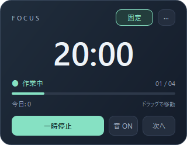
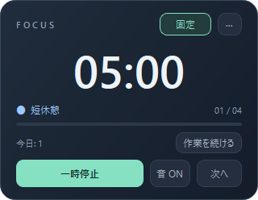
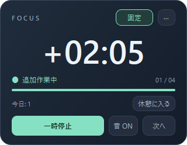

# Focus Pomodoro（pmd-timers）

[日本語](#focus-pomodoropmd-timers) | [English](#english)

Focus Pomodoroはデスクトップに小さく表示して使うポモドーロタイマーです。作業と休憩を交互に計り、今日の作業回数や作業時間を記録します。

時間が来ても、もう少し作業を続けたいときは「作業を続ける」を押してください。追加の作業時間を計り、切りの良いところで「休憩に入る」を押すと、予定していた休憩を始められます。



画像は現在のWindows用UIから撮影しています。表示している時間と完了数は撮影用の例です。

このアプリはClaudeなどの生成AIとの協働で開発しています。コード・仕様書・ドキュメントの多くにAIを使用しています。利用は自己責任でお願いします。動作確認の範囲は[検証記録](docs/focus-validation.md)にまとめています。

## Windowsで使い始める

ビルド済みの配布フォルダを開き、`FocusPomodoro.exe`をダブルクリックすると起動します。Pythonのインストールは不要です。同じフォルダにある`_internal`も実行に必要なので、EXEと一緒に保管してください。

配布ファイルは[Releases](https://github.com/akasaya/pmd-timers/releases)にあります。このREADMEはFocusの画面と機能を説明しています。従来の`PomodoroTimer.exe`とは実行ファイル名が異なります。ソースからFocusを作る場合は、後述の[Windows用EXEの作成](#windows用exeの作成)を参照してください。

## 作業と休憩を進める

「開始する」を押すと作業タイマーが動きます。初期設定は作業25分、短休憩5分、長休憩15分です。作業時間が終わると短休憩が始まり、4回目の作業のあとは短休憩の代わりに長休憩に入ります。

休憩が終わると、次の作業を始められる待機状態になります。続けて自動で始めたい場合は、設定で「休憩終了後に次の作業を自動スタート」をオンにしてください。

途中で席を離れるときは「一時停止」、戻ったら「再開する」を押します。タイマーのウィンドウを選択している間は、Spaceキーでも開始・一時停止・再開を切り替えられます。「次へ」は現在の作業や休憩をスキップするボタンです。

最初からやり直す場合は「···」メニューの「リセット」を選びます。終了する場合も、このメニューの「終了」を選んでください。カードを右クリックしても同じメニューを開けます。

## 時間が来ても作業を続けたいとき

作業が終わって休憩画面に切り替わったら、「作業を続ける」を押してください。休憩タイマーが止まり、追加作業の経過時間を`+00:00`から表示します。終了時刻を決めずに、切りの良いところまで作業できます。

追加作業中は、同じ位置のボタンが「休憩に入る」に変わります。もう一度押すと、もとの短休憩または長休憩が最初から始まります。追加作業を始める前に休憩時間が少し進んでいても、休憩は全時間ぶん確保されます。

初期設定では、追加作業が合計5分に達するごとに、次の休憩を1分増やします。たとえば追加作業が5分なら短休憩は6分、10分なら7分になります。長休憩にも同じように加算します。5分未満は加算せず、一時停止している時間は数えません。

同じ休憩から何度か追加作業へ戻った場合は、その作業時間を合算します。3分と2分に分けて作業しても、合計5分として休憩を1分増やします。ボタンを押し直すだけで二重に加算されることはありません。次の通常作業へ進むと合計をリセットします。

設定の「追加作業に応じて休憩を増やす」で無効にすることも、追加作業の間隔と増やす休憩時間を変えることもできます。加算ルールは、その休憩で最初に追加作業を始めた時点の設定を使います。途中で設定を変えた場合は、次の休憩から適用します。閾値に達しただけでは音や通知を出さず、「休憩に入る」を押すと加算後の時間が表示されます。

追加作業も一時停止・再開できます。「次へ」を押した場合も、予定していた休憩へ移ります。追加分は作業時間に加算されますが、ポモドーロの完了回数は増えません。追加作業をリセットした場合も、その時点までの作業時間を記録します。

| 作業終了後 | 追加作業中 |
| --- | --- |
|  |  |

## デスクトップでの表示を調整する

画面には大きな残り時間、進捗バー、作業や休憩の状態、長休憩までの作業回数、今日の完了数を表示します。初期サイズは320×248です。

「固定」をオンにすると、ほかのアプリを操作していてもタイマーを最前面に表示できます。カードをドラッグして移動すると、その位置を保存します。複数のモニターがある環境では、画面の範囲内に位置を調整します。

操作ボタンは初期設定で常に表示されます。設定の「ホバー時のみ操作ボタンを表示」をオンにすると、マウスを乗せたときだけ下部の操作ボタンが現れます。以前からこの設定を使っている場合は、その設定を引き継ぎます。

設定ではウィンドウの不透明度も変えられます。画面を薄く表示したい場合は値を下げ、くっきり表示したい場合は100%にしてください。マウスを乗せている間は100%で表示します。

## 通知音とBGMを使う

作業や休憩のタイマーが終わると、通知音とデスクトップ通知で知らせます。一時停止・リセット・手動スキップでは終了通知を出しません。通知音とデスクトップ通知は、それぞれ設定でオン・オフを選べます。

通知音には標準の音のほか、WAV・MP3・OGG・FLACなどの音声ファイルを選べます。設定画面では音を試聴できます。WAVは再生する区間を指定でき、通知音の再生は最大5秒です。

BGMは作業中と休憩中で別々のファイルを指定できます。それぞれ音量を調整でき、再生中は曲を繰り返します。追加作業には作業用のBGMを使い、一時停止中と待機中はBGMを止めます。

画面の「音 ON」「音 OFF」を押すと、通知音とBGMをまとめてミュート・解除できます。ミュートの状態は再起動後も引き継ぎます。デスクトップ通知を止める場合は、設定で通知自体をオフにしてください。

## 作業記録を振り返る

「···」から「統計を見る」を選ぶと、今日の完了回数、作業時間、休憩回数、連続して作業を完了した日数を確認できます。今日の記録には各作業と休憩の開始・終了時刻も表示します。

期間を切り替えると、日ごとの完了回数と、その期間で最も多く完了した日を確認できます。「今週」は今日を含む直近7日間、「今月」は月初から今日までを集計します。QtChartsを利用できる環境では棒グラフで表示し、利用できない環境では文字で表示します。

追加作業の時間も今日の作業時間に含まれます。追加作業だけで完了回数や中断回数が増えることはありません。

## 自分に合わせて設定する

「···」の「設定」から、時間、表示、通知音、BGM、言語を変更できます。言語は日本語とEnglishから選べます。設定を確定するとメイン画面に反映され、キャンセルした変更は保存しません。

| 設定 | 初期値 | 変更できる範囲・動作 |
| --- | --- | --- |
| 作業時間 | 25分 | 5〜90分 |
| 短休憩 | 5分 | 1〜30分 |
| 長休憩 | 15分 | 5〜60分 |
| 長休憩までの作業回数 | 4回 | 2〜10回 |
| 追加作業に応じた休憩加算 | オン | 短休憩・長休憩の両方に適用 |
| 休憩を増やす追加作業の間隔 | 5分 | 1〜90分 |
| 間隔ごとに増やす休憩 | 1分 | 1〜30分 |
| 常に最前面に表示 | オン | 「固定」ボタンからも変更可能 |
| ウィンドウの不透明度 | 95% | 20〜100% |
| ホバー時のみ操作ボタンを表示 | オフ | オフなら下部の操作ボタンを常時表示 |
| 休憩後の自動開始 | オフ | オンなら休憩終了後に次の作業を開始 |
| 通知音・デスクトップ通知 | オン | それぞれオン・オフを選択 |
| 作業中BGM・休憩中BGM | 無効 | 音声ファイルと音量を個別に設定 |
| ミュート | オフ | 通知音とBGMをまとめてオン・オフ |
| 言語 | 日本語 | 日本語・English |

## 設定と履歴の保存先

設定は`settings.json`、履歴は`history`フォルダにJSON形式で保存します。アプリを更新しても同じ保存先を使います。

| OS | 保存先 |
| --- | --- |
| Windows | `%APPDATA%\pmd-timers\` |
| macOS | `~/Library/Application Support/pmd-timers/` |
| Linux | `~/.config/pmd-timers/` |

Linuxで`XDG_CONFIG_HOME`を指定している場合は、そのフォルダの下に保存します。バックアップするときは、設定と履歴のフォルダをコピーしてください。

進行中のタイマーの残り時間はアプリを終了すると復元されません。設定と保存済みの作業記録は残ります。

## ソースから起動する

主な対象はWindows 10 / 11です。Pythonから起動する場合はPython 3.12以降を使用します。Focusの検証記録にはWindowsでのEXEの動作と、Linuxで画面を表示せずに行ったテストを記載しています。現在のFocus画面について、macOSでの確認結果はありません。

このREADMEと同じブランチのソースを取得し、リポジトリ直下でコマンドを実行してください。仮想環境にはPyQt6、PyQt6-Charts、plyerをインストールします。

WindowsのPowerShellでは、次のように起動します。

```powershell
python -m venv .venv
.\.venv\Scripts\python.exe -m pip install -r requirements.txt
.\.venv\Scripts\python.exe -m src.main
```

LinuxやmacOSでは、次のコマンドを使います。

```bash
python3 -m venv .venv
.venv/bin/python -m pip install -r requirements.txt
.venv/bin/python -m src.main
```

## Windows用EXEの作成

WindowsのPython環境で依存ライブラリを導入したあと、PyInstallerを追加してビルドします。

```powershell
.\.venv\Scripts\python.exe -m pip install pyinstaller
.\.venv\Scripts\python.exe scripts/build_windows.py
```

`dist\FocusPomodoro\`にEXEと実行に必要なファイルが生成されます。配布するときは、このフォルダをまとめて渡してください。

### ショートカットとログイン時起動の登録

ビルド後に次のコマンドを実行すると、デスクトップ、スタートメニュー、ログイン時起動に登録します。

```powershell
powershell -ExecutionPolicy Bypass -File scripts/install_windows.ps1 -AutoStart
```

アプリは`%LOCALAPPDATA%\Programs\FocusPomodoro\<インストール日時>`にコピーされます。更新時も以前の実行ファイルを残し、既存のポモドーロ用スタートアップショートカットを新しい実行ファイルへ向けます。変更前のショートカットは配置先の`shortcut-backups`に保存します。元の場所は同じフォルダの`restore.txt`で確認できます。

ログイン時起動を新しく登録する必要がなければ、`-AutoStart`を外してください。すでに登録済みの自動起動を解除する場合は、`Win+R`で`shell:startup`を開き、該当のショートカットを削除してください。

## 開発時の検証

Linuxではプロジェクトの仮想環境から次のようにテストできます。

```bash
.venv/bin/python -m pip install pytest ruff
QT_QPA_PLATFORM=offscreen .venv/bin/python -m pytest tests/ -q
QT_QPA_PLATFORM=offscreen .venv/bin/python -m src.main --smoke-test build/focus-preview.png
```

スモークテストは画面を操作して基本動作を確かめる検査です。開始、一時停止、再開、スキップ、追加作業と休憩への復帰、最前面表示の切り替えを確認し、画面の画像を保存します。ユーザーの設定や履歴は変更せず、通知や音も出しません。

WindowsではビルドしたEXEにも同じ検査を実行できます。

```powershell
.\dist\FocusPomodoro\FocusPomodoro.exe --smoke-test build\focus-windows-preview.png
```

追加作業と休憩加算を含むテスト108件と、WindowsのEXEのスモークテストを確認しています。長時間の連続運転、スリープ復帰、ログインし直したときの自動起動、通知音の実聴は未確認です。詳しい結果は[Focusの検証記録](docs/focus-validation.md)を参照してください。

## 仕様とコードを読む

タイマーの状態と作業記録の型は`src/engine/`、設定・履歴・通知・統計の処理は`src/services/`にあります。メイン画面、設定画面、統計画面は`src/ui/`、日本語と英語の表示文は`src/locale/`で管理しています。

これまでの仕様・設計は機能ごとに`specs/`へ保存しています。

| ドキュメント | 内容 |
| --- | --- |
| [004-desktop-pomodoro-timer](specs/004-desktop-pomodoro-timer/) | デスクトップ常駐タイマー |
| [005-compact-stats-dashboard](specs/005-compact-stats-dashboard/) | 小型ウィンドウと統計画面 |
| [006-fix-ui-bugs](specs/006-fix-ui-bugs/) | UIの不具合修正 |
| [007-sound-multimonitor](specs/007-sound-multimonitor/) | カスタム通知音と複数モニターへの対応 |
| [008-phase-bgm](specs/008-phase-bgm/) | 作業・休憩ごとのBGM |
| [009-auto-resume-work](specs/009-auto-resume-work/) | 休憩後の自動開始 |
| [010-i18n-support](specs/010-i18n-support/) | 多言語対応の仕様と設計 |
| [011-mute-toggle](specs/011-mute-toggle/) | 通知音とBGMのミュート |
| [012-i18n-support](specs/012-i18n-support/) | 日本語・英語の表示切り替え |

## English

Focus Pomodoro is a small desktop timer for alternating work and breaks. It shows the remaining time, progress, session number, and today's completed count. This project is developed with generative AI, including Claude. Use it at your own risk; see the [validation record](docs/focus-validation.md) for tested behavior and limitations.

### Start and keep working

Open `FocusPomodoro.exe` from the built distribution folder. Keep its `_internal` folder beside it; Python is not required to run the packaged app. Published downloads are listed on [Releases](https://github.com/akasaya/pmd-timers/releases). The older executable is named `PomodoroTimer.exe`.

Select “Start focus” to begin. Defaults are 25 minutes of work, a 5-minute short break, and a 15-minute long break after the fourth work session. Breaks begin automatically. After a break, the timer waits for you unless auto-start is enabled. Use “Pause” and “Resume,” or press Space while the timer window is focused. “Skip” moves to the next phase. The menu contains reset, settings, statistics, and quit.

If you want to continue after work ends, select “Keep working” on the break screen. The timer counts additional time upward from `+00:00`. Select “Start break” in the same place when you are ready. Your original short or long break starts with its full duration. Extra work can be paused and resumed; it adds to work time without increasing completed or interrupted session counts.

By default, every full 5 minutes of extra work adds 1 minute to the following break. A 5-minute short break becomes 6 minutes after 5 minutes of extra work, or 7 minutes after 10 minutes. This also applies to long breaks. Repeated extensions of the same break are combined; paused time is excluded. The total resets when the next regular work session begins. Settings let you disable this feature or change the work interval (1–90 minutes) and added break time (1–30 minutes). The rule is captured when extra work first starts for a break, so later edits apply to the next break. Crossing an interval does not trigger an alert.

### Display, sound, and history

Drag the window to move it; its position is saved. “Pin” keeps it above other windows. Controls are always visible by default, with an optional hover-only setting. Opacity can be adjusted from 20% to 100%. Settings support Japanese and English.

Notifications and sounds announce timer completion. Manual pause, reset, and skip do not trigger completion alerts. Choose a custom notification sound, preview it, and select a playback segment for WAV files. Notification playback is limited to 5 seconds. Work and break BGM have separate tracks and volume controls and play in a loop. Extra work uses the work track. “Sound” and “Muted” toggle both notification sounds and BGM; desktop notifications have a separate setting.

Statistics show today's completed sessions, work time, breaks, streak, and session times. The week view covers the last 7 days, and the month view covers the first day of the month through today. Daily counts appear as a chart when QtCharts is available, with a text fallback otherwise.

Settings and saved history remain in `%APPDATA%\pmd-timers\` on Windows, `~/Library/Application Support/pmd-timers/` on macOS, and `~/.config/pmd-timers/` on Linux, or under `XDG_CONFIG_HOME` when set. An active timer's remaining time is not restored after the app exits.

### Run from source or build

Use Python 3.12 or later and the same branch as this README. From the repository root, create a virtual environment, install `requirements.txt`, and run `python -m src.main` with that environment's Python. On Windows, install PyInstaller and run `python scripts/build_windows.py`; distribute the entire `dist/FocusPomodoro/` folder.

After building, run `powershell -ExecutionPolicy Bypass -File scripts/install_windows.ps1 -AutoStart` to install into a new folder and register desktop, Start menu, and startup shortcuts. Previous executables and replaced shortcuts are retained. Omit `-AutoStart` to skip startup registration; remove an existing startup shortcut through `Win+R` → `shell:startup` to disable it.

Run `python -m pytest tests/ -q` after installing pytest. On headless Linux, set `QT_QPA_PLATFORM=offscreen`. The packaged executable also supports `--smoke-test <image.png>` to check UI controls without changing settings or history or playing sounds. The current validation record covers Windows and Linux offscreen tests, not the current Focus UI on macOS.
